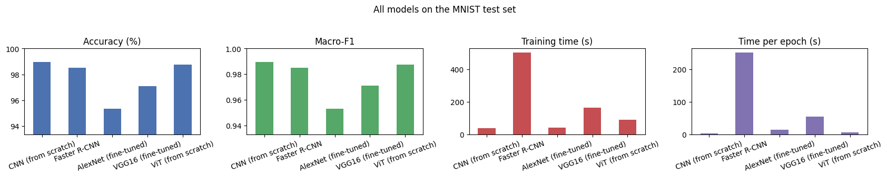

# Lab 2 — Deep Learning with PyTorch (MNIST, GPU)

**Student:** Anas Rabih Senhaji
**Course:** Deep Learning — Pr. ELAACHAK Lotfi — FST Tanger, LSI

Notebook: `Lab2_Deep_Learning.ipynb` (Google Colab, Tesla T4). Split: 55,000 train / 5,000 validation / 10,000 test, seed 42.

## Results (test set)

| Model | Accuracy | Macro-F1 | Loss | Train time | Params |
|---|---|---|---|---|---|
| CNN (scratch) | **98.94 %** | **0.9893** | 0.0320 | 38 s | 1.6 M |
| ViT (scratch) | 98.74 % | 0.9873 | 0.0399 | 89 s | 0.14 M |
| Faster R-CNN | 98.51 % | 0.9851 | 0.0441 (detection loss) | 502 s | 41.3 M |
| VGG16 (fine-tuned) | 97.11 % | 0.9709 | 0.0888 | 165 s | 134.3 M |
| AlexNet (fine-tuned) | 95.36 % | 0.9528 | 0.1395 | 42 s | 57.0 M |

## Part 1

**1.1 CNN.** `Conv(1→32, 3×3, padding 1, stride 1) → ReLU → Conv(32→64, 3×3) → ReLU → MaxPool(2×2) → Dropout(0.25) → FC(12544→128) → ReLU → Dropout(0.5) → FC(10)`. SGD (lr 0.01, momentum 0.9), weight decay 1e-4, batch 128, early stopping (stopped at epoch 10, best epoch 7). Trained on GPU: **98.94 %**.

**1.2 Faster R-CNN.** A box is computed around each digit's pixels. torchvision Faster R-CNN (ResNet-50 + FPN, COCO-pretrained), predictor replaced by 11 classes; the prediction is the label of the best box. 2 epochs on 8,000 images: **98.51 %** (mean IoU 0.94).

**1.3 Comparison.** The CNN is slightly more accurate and much cheaper: Faster R-CNN needs 13× more training time, has 25× more parameters and is about 370× slower at inference. The two losses are not comparable (cross-entropy vs detection loss).

**1.4 Fine-tuning VGG16 and AlexNet.** ImageNet weights, last layer replaced by 10 classes, convolutional layers frozen, 64×64 input, 3 epochs: **97.11 %** (VGG16) and **95.36 %** (AlexNet), both below the CNN (98.94 %). **Conclusion:** for MNIST, a small CNN trained from scratch is the best choice here. Only the fully-connected layers were trained, so unfreezing the convolutional layers could improve the pretrained models (not tested).

## Part 2 — Vision Transformer

**2.1 ViT from scratch.** 28×28 image → 49 patches of 4×4 → linear embedding + `[CLS]` token + sinusoidal positional encoding → 4 encoder blocks (4-head self-attention + MLP, residuals, LayerNorm), hidden size 64, 135,818 parameters. AdamW, 15 epochs: **98.74 %**.

**2.2 Interpretation.** The ViT is close to the CNN (20 images of difference out of 10,000, within single-run noise) with 12× fewer parameters, but it trains more slowly per epoch and needs more epochs. It is also close to Faster R-CNN and better than the fine-tuned VGG16 and AlexNet. With one run per model, small differences should not be over-interpreted.

## Personal synthesis

- I learned how convolution, pooling and fully connected layers work together; a small CNN gave the best result (98.94 %).
- I learned to fine-tune VGG16 and AlexNet (replace the output layer, freeze layers); pretrained models are not automatically better.
- Faster R-CNN is built for detection: it was accurate here but much slower and heavier than the CNN.
- Building a ViT from scratch taught me patch embedding, positional encoding, attention and the class token; it matched the CNN with far fewer parameters.
- I learned to compare models on accuracy, F1 and cost, and not to over-interpret small differences from a single run.

## Run

Open the notebook in Google Colab → `Runtime → Change runtime type → T4 GPU` → `Run all` (about 15–20 min).
